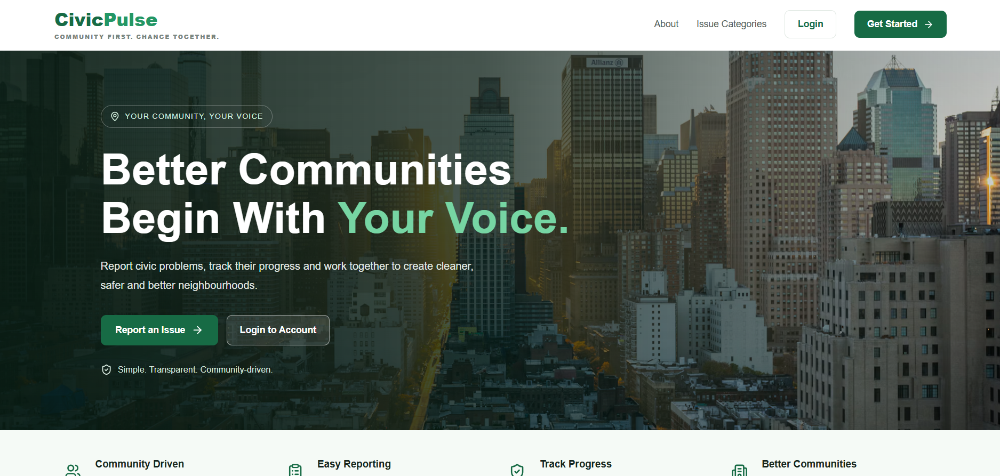
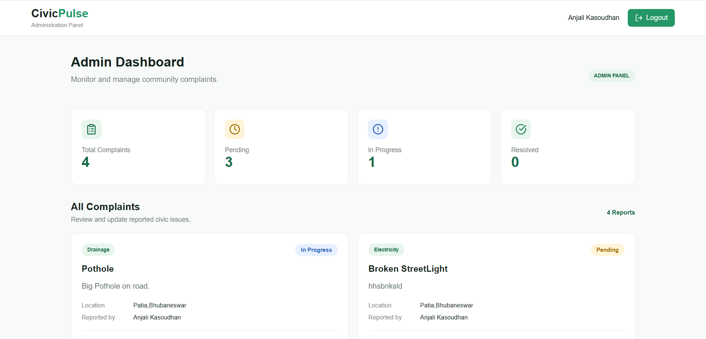
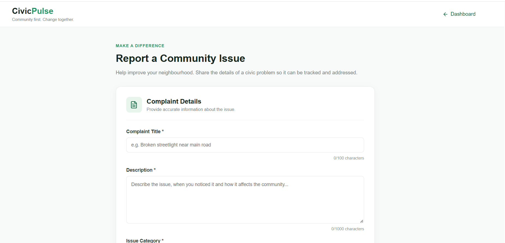
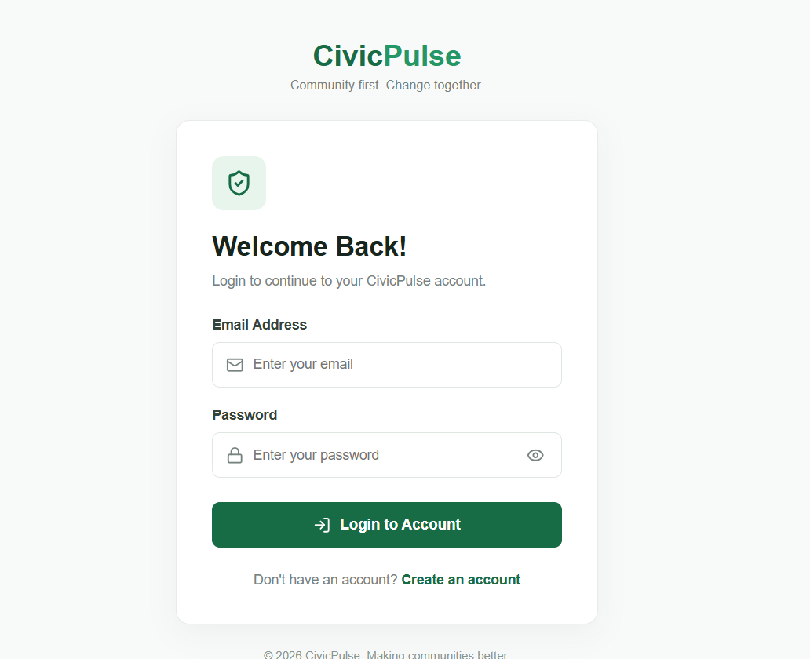

# CivicPulse-
Civic Issue Reporting and Resolution Platform
# CivicPulse – Civic Issue Reporting & Resolution Platform

**Community First. Change Together.**

CivicPulse is a MERN stack web application that allows citizens to report civic issues in their neighbourhood, track complaint progress and stay informed about community problems.

The platform provides a dedicated admin dashboard where administrators can view reported complaints and update their status, helping make civic issue management more organized and transparent.

## Features

### Citizen Features
- User registration and login.
- Secure authentication using JWT.
- Report civic issues with title, description, category and location.
- View complaints submitted by other citizens.
- View and track personal complaints.
- Check complaint status.
- Responsive citizen dashboard with complaint statistics.

### Admin Features
- Dedicated admin dashboard.
- View all submitted complaints.
- View complaint details and reporter information.
- Update complaint status.
- Manage complaints through a centralized dashboard.

### Complaint Statuses
- Pending
- In Progress
- Resolved
- Rejected

## Technology Stack

| Technology | Purpose |
|---|---|
| React.js | Frontend user interface |
| Vite | Frontend development server |
| Node.js | Backend runtime |
| Express.js | Backend API |
| MongoDB Atlas | Cloud database |
| Mongoose | MongoDB object modeling |
| JWT | Authentication |
| bcryptjs | Password hashing |
| Axios | API communication |
| React Router | Frontend routing |
| Lucide React | Icons |
| CSS | Styling and responsive design |

## Project Structure

```text
CivicPulse/
│
├── client/
│   ├── src/
│   │   ├── components/
│   │   ├── context/
│   │   │   └── AuthContext.jsx
│   │   ├── pages/
│   │   │   ├── Landing.jsx
│   │   │   ├── Register.jsx
│   │   │   ├── Login.jsx
│   │   │   ├── DashBoard.jsx
│   │   │   ├── ReportIssue.jsx
│   │   │   ├── MyComplaints.jsx
│   │   │   ├── AllComplaints.jsx
│   │   │   └── AdminDashboard.jsx
│   │   ├── services/
│   │   │   └── api.js
│   │   ├── App.jsx
│   │   ├── main.jsx
│   │   └── index.css
│   └── package.json
│
└── server/
    ├── config/
    │   └── db.js
    ├── controllers/
    │   ├── authController.js
    │   └── complaintController.js
    ├── middleware/
    │   ├── authMiddleware.js
    │   └── adminMiddleware.js
    ├── models/
    │   ├── User.js
    │   └── Complaint.js
    ├── routes/
    │   ├── authRoutes.js
    │   ├── complaintRoutes.js
    │   └── healthRoutes.js
    ├── scripts/
    │   └── promoteAdmin.js
    ├── app.js
    ├── server.js
    └── package.json
```

## Installation and Setup

### 1. Clone the Repository

```bash
git clone https://github.com/Anjalikasoudhan/CivicPulse-.git
cd CivicPulse-
```

### 2. Backend Setup

```bash
cd server
npm install
```

Create a `.env` file inside the `server` folder:

```env
PORT=5000
MONGO_URI=your_mongodb_connection_string
JWT_SECRET=your_secure_jwt_secret
ADMIN_EMAIL=your_admin_email
```

Replace the placeholder values with your own configuration. Never upload your actual `.env` file or credentials to GitHub.

Start the backend:

```bash
npm run dev
```

Backend runs at:

`http://localhost:5000`

### 3. Frontend Setup

Open another terminal:

```bash
cd client
npm install
```

Create a `.env` file inside the `client` folder:

```env
VITE_API_URL=http://localhost:5000/api
```

Start the frontend:

```bash
npm run dev
```

Frontend runs at:

`http://localhost:5173`

## API Endpoints

### Authentication

| Method | Endpoint | Description |
|---|---|---|
| POST | `/api/auth/register` | Register a new citizen |
| POST | `/api/auth/login` | Login user |

### Complaints

| Method | Endpoint | Description |
|---|---|---|
| POST | `/api/complaints` | Submit a complaint |
| GET | `/api/complaints` | View all complaints |
| GET | `/api/complaints/my` | View personal complaints |
| GET | `/api/complaints/admin/all` | Admin: view all complaints |
| PUT | `/api/complaints/:id/status` | Admin: update complaint status |

Protected endpoints require a valid JWT access token.

## User Roles

**Citizen:** Can register, log in, submit complaints and track complaint progress.

**Admin:** Can access the administration dashboard, view complaints and update their status.

Admin access is assigned through the backend rather than public registration.

## Security

- Passwords are hashed using bcryptjs.
- JWT is used for authentication.
- Protected routes restrict unauthorized access.
- Admin middleware restricts administrative operations.
- Environment variables store sensitive configuration.

## Future Enhancements

- Upload photographs as complaint evidence.
- Interactive map for complaint locations.
- Email notifications for complaint updates.
- Advanced complaint analytics.
- Search and filter improvements.
- Deployment for public access.

## Screenshots

### Landing Page


### Citizen Dashboard


### Admin Dashboard


### Report Issue


### Login Page

## Project Objective

Deploy Link - https://civic-pulse-one-opal.vercel.app/
The objective of CivicPulse is to provide a simple and accessible platform where citizens can raise local issues and track their resolution.

**CivicPulse – Making communities better, one report at a time.**
